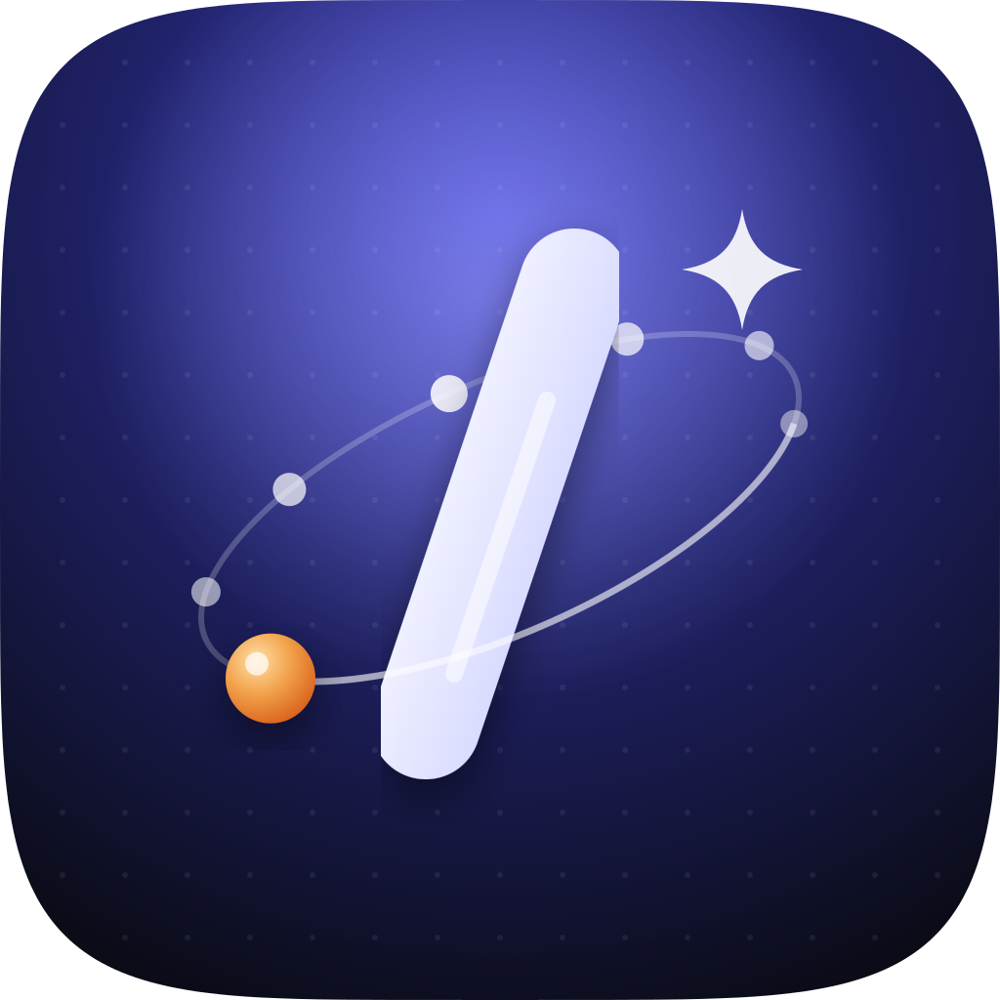
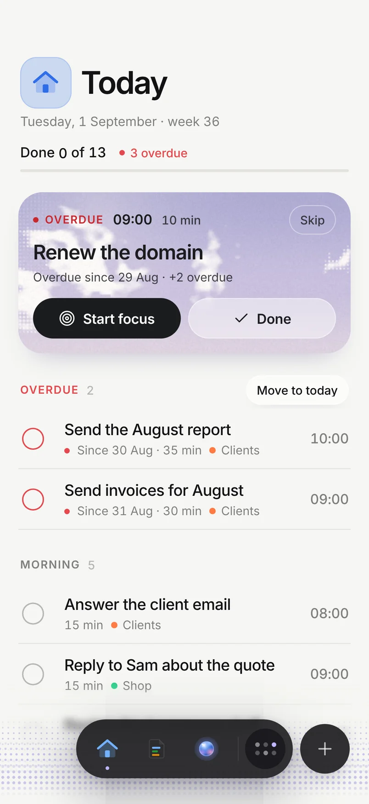
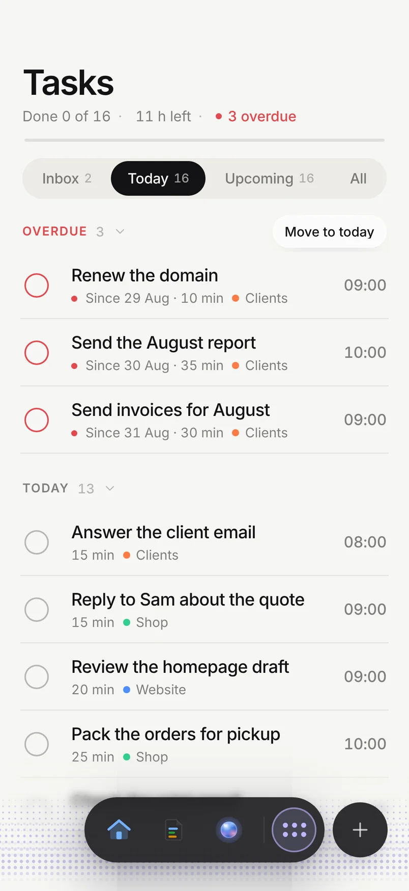
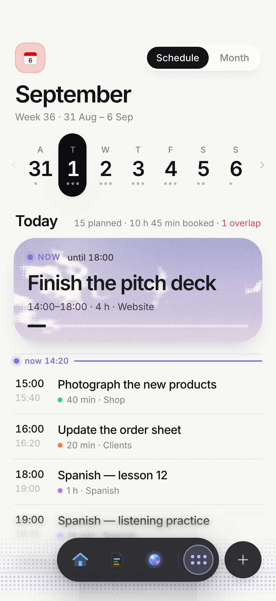
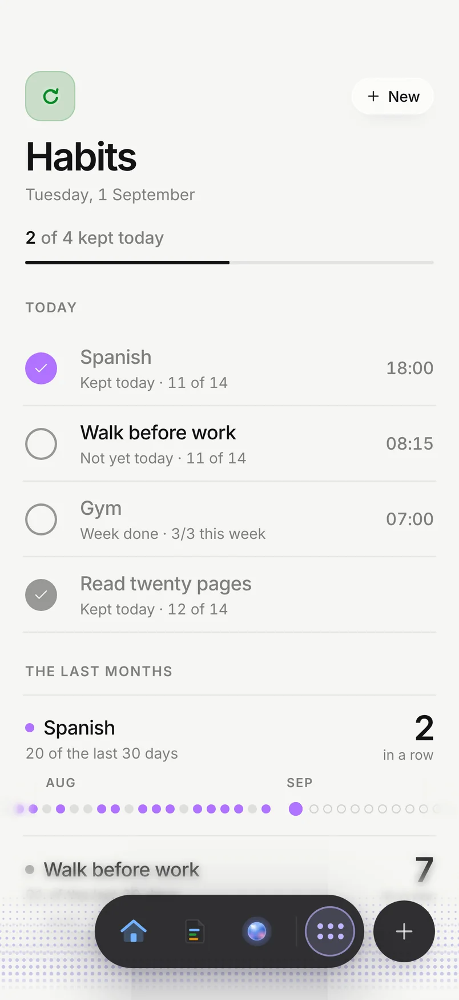
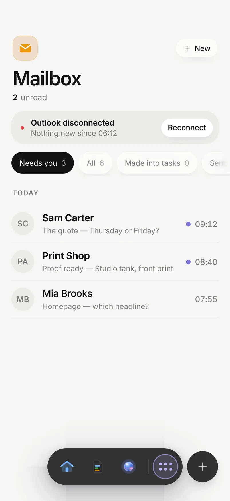

<div align="center">



# Needt Plugin

**Eight skills that make your AI sharper — and one that runs your day inside Needt.**

A business partner, a researcher, a prompt builder, a grill-me, a plan critic and a YouTube reader, free.
Plus `/needt`, which gives your AI your whole planner: tasks, calendar, habits, pages, mail and memory.

[](https://github.com/teenxgrailed/needt-plugin/releases)
[](LICENSE)
[](https://needt.app/resources/mcp/)
[](#install)

[Install](#install) · [Skills](#the-skills) · [How it works](#how-it-works) · [Privacy](#privacy) · [needt.app](https://needt.app/plugin/)

</div>

---

<p align="center">
  
  
  
  
  
</p>
<p align="center"><sub>Real Needt screens. <code>/needt</code> calls Needt's own tools over MCP — the same ones the app uses.</sub></p>

## Install

| Where | How |
|---|---|
| **Claude** (web, Desktop) | Download [`needt.plugin`](https://github.com/teenxgrailed/needt-plugin/releases/latest) → **Customize → Plugins → Add → Upload plugin** |
| **Claude Code** | `claude plugin marketplace add teenxgrailed/needt-plugin` then `claude plugin install needt@needt` |
| **Codex** | `codex plugin marketplace add teenxgrailed/needt-plugin` |
| **Single skills** | Download a skill zip from the [latest release](https://github.com/teenxgrailed/needt-plugin/releases/latest) → **Customize → Skills → Upload** |
| **Any MCP client** | Remote server `https://mcp.needt.app/mcp` (streamable HTTP, OAuth) |

Then start a new chat and just talk — *"what's on today?"*, *"help me think about pricing"*, *"find the best way to…"*. You never have to name a skill.

## The skills

| Skill | What it does | |
|---|---|---|
| **`/needt`** | Your planner in every chat. Adds, moves and finishes tasks, breaks plans into steps, reads your day across calendars, logs habits, writes pages, turns mail into tasks, remembers how you work. Starts on its own when you say *"add…"*, *"remind me…"*, *"what's today"*, *"move…"*, *"done"* — in English, Russian, Ukrainian, German, Spanish and French. | **Pro** |
| **`/needt:partner`** | Business partner. Reads your real numbers from whatever your AI is connected to, finds the real question, picks the best of two or three moves, does the work and lands it in Needt. Calls the other skills itself. Money ends in a verdict: *take*, *take if X*, *walk*. | Free |
| **`/needt:search`** | Research that finds the good option, not the first one. Web, YouTube transcripts, X and GitHub, wide first then deep. Opens with the **Find** — the non-obvious thing — and dates every source. | Free |
| **`/needt:prompt`** | A rough wish becomes one prompt of the right size, with stages that use the other skills. | Free |
| **`/needt:asking`** | Grill-me: clickable questions in rounds until nothing is assumed. A short mode the other skills use to clarify. | Free |
| **`/needt:critic`** | Takes a plan apart before launch, gently: every finding is **problem → solution → cost → confidence**, then the fixed plan in full. | Free |
| **`/needt:youtube`** | Paste a YouTube link and ask. Pulls title, chapters, description and the timestamped transcript, answers with `[mm:ss]`. | Free |
| `+setup` | Internal. Prints the `Needt ·` readiness line, onboards tools once, reads your memory. | Free |

`/needt` needs a [Needt Pro](https://needt.app/pricing/) account — it connects to your planner over MCP. Every other skill works without an account.

## How it works

**One readiness line.** The first skill you use in a chat prints a line like
`Needt · ready · project: Acme · tone: casual · search: web, youtube, github · questions: click · agents: yes · memory: 12`.
Every other skill reads it instead of checking again. It costs no tool calls.

**Memory that follows you.** When you say *"remember…"*, *"never do X again"*, or correct how something was done, the plugin saves one line to your Needt memory (`Saved: …`) and every skill treats it as a standing instruction — in any chat, on any device. Secrets, health details and one-off facts are never saved. Turn it off any time in the Needt app.

**Uses what your AI already has.** Skills route to the tools your host exposes — web search, Firecrawl, Exa, GitHub, Context7, YouTube — and say so when something is missing instead of faking it. On first run, setup lists free ways to add the missing ones in a few lines.

**Parallel and cheap.** Independent research runs in parallel sub-agents on a faster model; synthesis, judgement and verdicts stay with the main model.

**Asks only when it matters.** Reversible actions run and get reported in one line. Sending, posting, paying and deleting always wait for your yes.

## What's in this repo

```
plugins/needt/                 the plugin (skills, manifests, MCP connection)
  skills/<name>/SKILL.md       one folder per skill
  .mcp.json                    https://mcp.needt.app/mcp
.claude-plugin/marketplace.json   Claude Code marketplace
.agents/plugins/marketplace.json  Codex marketplace
server.json                    MCP Registry entry
glama.json                     Glama listing
assets/                        icon and screenshots
```

## Privacy

The plugin is Markdown instructions, one small Python script for YouTube transcripts (runs only if `yt-dlp` is installed), and one MCP connection to `https://mcp.needt.app/mcp`. No hooks, no telemetry. Your assistant reads and writes your own Needt data through that server after you sign in with OAuth; nothing else is sent anywhere by the plugin.

[Privacy policy](https://use.needt.app/privacy) · [Terms](https://use.needt.app/terms)

## Support and contributing

Questions and bugs: [open an issue](https://github.com/teenxgrailed/needt-plugin/issues) or write to hello@needt.app.
Ideas for a skill, a better trigger phrase in your language, a sharper rule — pull requests are welcome. Run `claude plugin validate plugins/needt` before sending one.

Changelog: [plugins/needt/README.md](plugins/needt/README.md#changelog).

<div align="center"><sub>Made by <a href="https://needt.app">Needt</a> · MIT License</sub></div>
