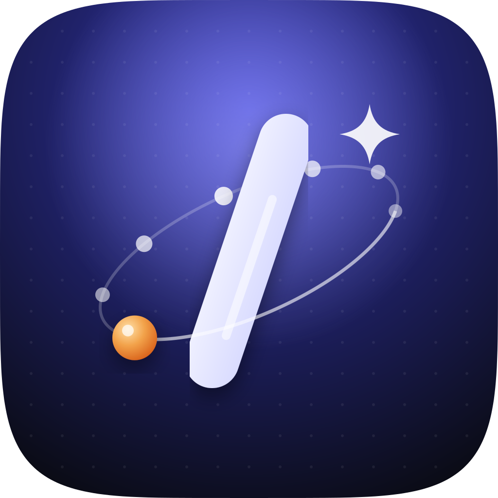
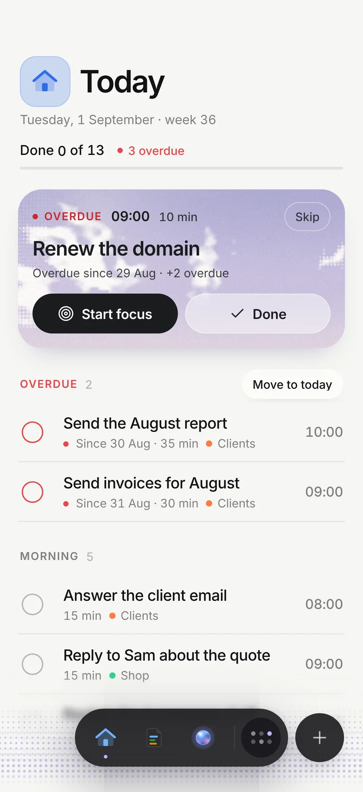
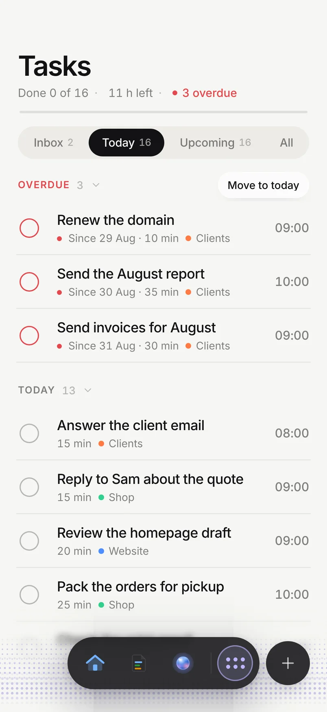
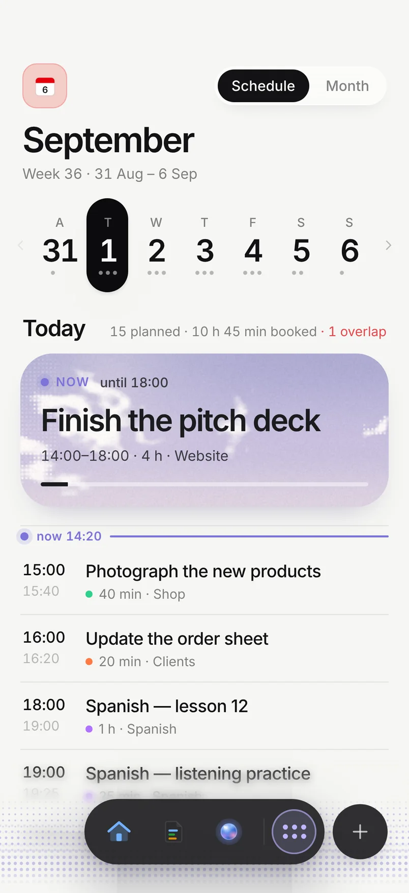
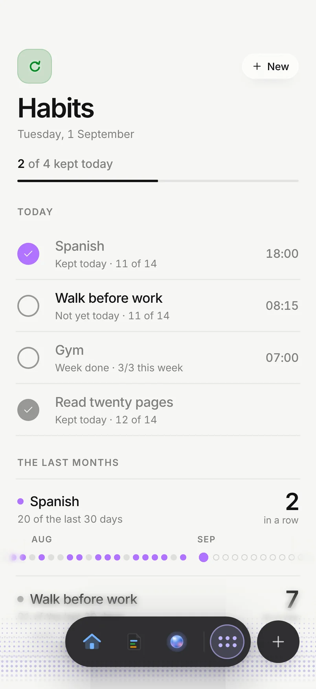
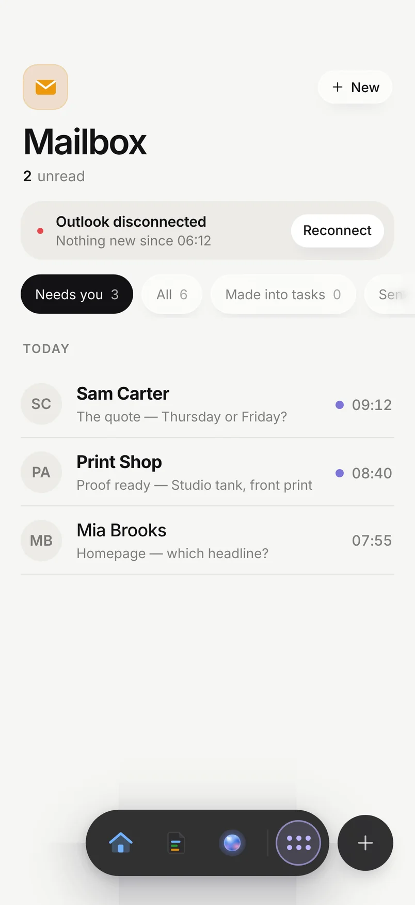

<div align="center">



# Needt Plugin

**Ten skills that make your AI sharper — and one that runs your day inside Needt.**

A business partner, a researcher, a prompt builder, a grill-me, a plan critic, a project roadmap, an explainer and a YouTube reader, free.
Plus `/needt`, which gives your AI your whole planner: tasks, calendar, habits, pages, mail and memory.

[](https://github.com/teenxgrailed/needt-plugin/releases)
[](LICENSE)
[](https://needt.app/resources/mcp/)
[](#install)
[](https://registry.modelcontextprotocol.io/v0/servers?search=needt)
[](https://plugandship.dev/p/needt)

[Install](#install) · [Skills](#the-skills) · [How it works](#how-it-works) · [Privacy](#privacy) · [needt.app](https://needt.app/plugin/)

</div>

---

<p align="center">
  
  
  
  
  
</p>
<p align="center"><sub>Real Needt screens. <code>/needt</code> calls Needt's own tools over MCP — the same ones the app uses.</sub></p>

## Install

**Claude Code** — one line:

```sh
claude plugin marketplace add teenxgrailed/needt-plugin && claude plugin install needt@needt
```

(or inside Claude Code: `/plugin install needt --marketplace teenxgrailed/needt-plugin`; update later with `claude plugin update needt@needt`)

**Claude** (web, Desktop) — [download `needt.plugin`](https://github.com/teenxgrailed/needt-plugin/releases/latest/download/needt.plugin), then **Customize → Plugins → Add → Upload plugin**.

| Where | How |
|---|---|
| **Codex** | `codex plugin marketplace add teenxgrailed/needt-plugin` |
| **Single skills** (Claude, Cursor, any agent that reads `SKILL.md`) | `npx skills add teenxgrailed/needt-plugin` and pick the ones you want, or download a skill zip from the [latest release](https://github.com/teenxgrailed/needt-plugin/releases/latest) → **Customize → Skills → Upload** |
| **Any MCP client** | Remote server `https://mcp.needt.app/mcp` (streamable HTTP, OAuth) |

Then start a new chat and just talk — *"what's on today?"*, *"help me think about pricing"*, *"find the best way to…"*, *"roadmap for my app"*. You never have to name a skill.

## The skills

| Skill | What it does | |
|---|---|---|
| **`/needt`** | Your planner in every chat. Adds, moves and finishes tasks, breaks plans into steps, reads your day across calendars, logs habits, writes pages, turns mail into tasks, remembers how you work. Starts on its own when you say *"add…"*, *"remind me…"*, *"what's today"*, *"move…"*, *"done"* — in English, Russian, Ukrainian, German, Spanish and French. | **Pro** |
| **`/needt:partner`** | Business partner. Reads your real numbers from whatever your AI is connected to, finds the real question, picks the best of two or three moves, does the work and lands it in Needt. Calls the other skills itself. Money ends in a verdict: *take*, *take if X*, *walk*. | Free |
| **`/needt:search`** | Research that finds the good option, not the first one. Web, YouTube transcripts, X and GitHub, wide first then deep. Opens with the **Find** — the non-obvious thing — and dates every source. | Free |
| **`/needt:prompt`** | A rough wish becomes one prompt of the right size, with stages that use the other skills — then one click: **Use prompt**, **Change something** or **Copy only**. | Free |
| **`/needt:asking`** | Grill-me: clickable questions in rounds until nothing is assumed. A short mode the other skills use to clarify. | Free |
| **`/needt:critic`** | Takes a plan apart before launch, gently: every finding is **problem → solution → cost → confidence**, then the fixed plan in full. | Free |
| **`/needt:roadmap`** | A project roadmap that survives sessions: milestones as tasks in Needt with blockers, *next* computed, *done* only on evidence (a merged PR, a file, your word), an append-only log and a handoff for the next session. In Claude Desktop it is a clickable metro map; *"where are we"*, *"what's left"*, *"handoff"* all land here. | **Pro** |
| **`/needt:learn`** | Explains one thing so it sticks: the mechanism at your level, an example from your own world, a clickable diagram or a map of the subject with what you have already passed, and one check question. No quiz loop. | Free |
| **`/needt:youtube`** | Any YouTube link in any message is read first — title, chapters, description, timestamped transcript — and the skill that owns the request works from it. Ask about it, make tasks from it, critique the plan in it. | Free |
| **`/needt:setup`** | First-run interview (plan, connectors, language, memory) and the `Needt ·` readiness line every skill reuses. | Free |

`/needt` and `/needt:roadmap` need a [Needt Pro](https://needt.app/pricing/) account — it connects to your planner over MCP. Every other skill works without an account.

## How it works

**Widgets.** In Claude Desktop, where the chat can render widgets, the skills show what has a
shape as one — today's list with Done buttons, option cards, money metrics, finding cards with
*Accept fix*, a subject map, a project roadmap as a metro map. Everywhere else the same answer arrives as
text. Rules: `plugins/needt/skills/setup/references/widgets.md`.

**A first run that asks.** The first time a skill fires, setup asks up to four clickable questions — which plan this AI app is on, what to connect, language and tone, memory — and saves the answers as one memory line. Say *"у меня Max"* or *"switch memory off"* later and it updates. `/needt:setup` runs it on demand.

**Fits your plan.** The readiness line carries `budget: pro | max | ultra | …`, and every skill scales to it: on Pro, research runs inline and no sub-agents start unless you ask; on Max, independent sweeps run in parallel on Sonnet; on Ultra, up to eight agents with the main model synthesising. Table: `plugins/needt/skills/setup/references/delegation.md`.

**One readiness line.** The first skill you use in a chat prints a line like
`Needt · ready · project: Acme · tone: casual · search: web, youtube, github · questions: click · agents: yes · memory: 12`.
Every other skill reads it instead of checking again; the first time it appears it says in one line what it is.

**Memory that follows you.** When you say *"remember…"*, *"never do X again"*, or correct how something was done, the plugin saves one line to your Needt memory (`Saved: …`) and every skill treats it as a standing instruction — in any chat, on any device. Secrets, health details and one-off facts are never saved. Turn it off any time in the Needt app.

**The skills call each other.** One skill owns each kind of request and the others hand over in the same reply: a YouTube link → youtube, an unsure fact → search, a missing answer → asking, a sequence that spans sessions → roadmap, work for today → needt. The map of owners and hand-offs: `plugins/needt/skills/setup/references/skills-map.md`.

**Uses your own skills too.** The readiness line counts the other skills in your catalog (`skills: n`), and every Needt skill hands the part they own to them — a deck to your pptx skill, a deploy to your runbook, a campaign to your marketing skill — briefed from what is already known and delivered in the Needt skill's voice. Rules: `plugins/needt/skills/setup/references/user-skills.md`.

**Uses what your AI already has.** Skills route to the tools your host exposes — web search, Firecrawl, Exa, GitHub, Context7, YouTube — and say so when something is missing instead of faking it. On first run, setup lists free ways to add the missing ones in a few lines.

**Parallel and cheap.** Independent research runs in parallel sub-agents on a faster model; synthesis, judgement and verdicts stay with the main model.

**Checks what it installs — and itself.** Every release passes a 30-scenario eval (`eval/`), its own SkillSpector scan (risk 25/100, no high findings) and size caps (each skill under 8 KB, each description under 600 characters). Before recommending a new skill, plugin or MCP server, the plugin scans it with [NVIDIA SkillSpector](https://github.com/NVIDIA/SkillSpector) when it is installed (risk 51+ means it is not installed), or reads its files for known red flags.

**Asks only when it matters.** Reversible actions run and get reported in one line. Sending, posting, paying and deleting always wait for your yes.

## What's in this repo

```
plugins/needt/                 the plugin (skills, manifests, MCP connection)
eval/                          release gate: scenarios and results per version
release.sh, build-standalone.py  gate + build
  skills/<name>/SKILL.md       one folder per skill
  .mcp.json                    https://mcp.needt.app/mcp
.claude-plugin/marketplace.json   Claude Code marketplace
.agents/plugins/marketplace.json  Codex marketplace
server.json                    MCP Registry entry
glama.json                     Glama listing
assets/                        icon and screenshots
```

## Privacy

The plugin is Markdown instructions, one small Python script for YouTube transcripts (runs only if `yt-dlp` is installed), and one MCP connection to `https://mcp.needt.app/mcp`. No hooks, no telemetry. Your assistant reads and writes your own Needt data through that server after you sign in with OAuth; nothing else is sent anywhere by the plugin.

[Privacy policy](https://use.needt.app/privacy) · [Terms](https://use.needt.app/terms)

## Support and contributing

Questions and bugs: [open an issue](https://github.com/teenxgrailed/needt-plugin/issues) or write to hello@needt.app.
Ideas for a skill, a better trigger phrase in your language, a sharper rule — pull requests are welcome. Run `claude plugin validate plugins/needt` before sending one.

Changelog: [plugins/needt/README.md](plugins/needt/README.md#changelog).

<div align="center"><sub>Made by <a href="https://needt.app">Needt</a> · MIT License</sub></div>
